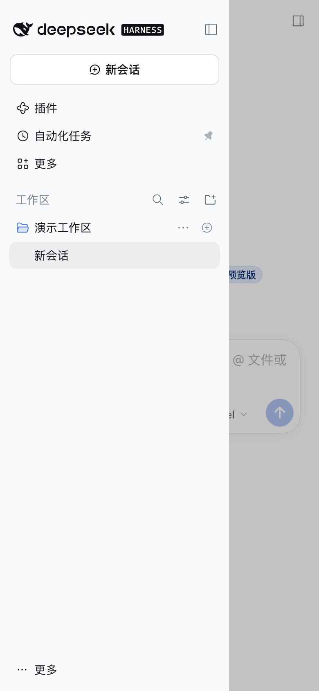
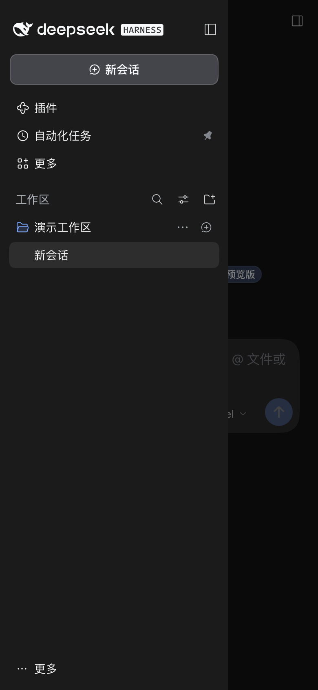
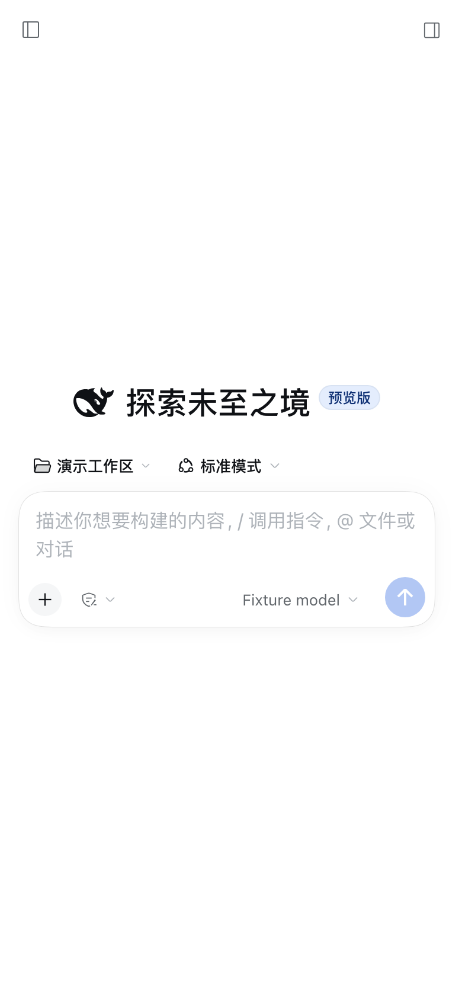
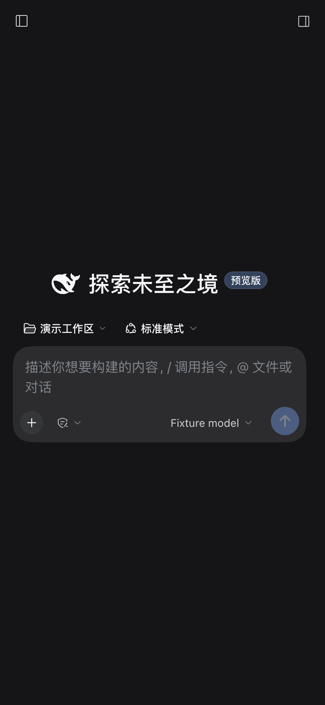

# dsh-swipe-back

[简体中文](README.md) · [Project documentation](docs/README.md)

On the phone Web UI (`< 768 px` drawer layout with no modal or menu open), swipe right from the left edge
to take the first available action:

1. Dismiss the open session drawer by swiping left or right from anywhere (works in Safari tabs too);
2. Navigate back one level inside Plugins or Schedules;
3. Leave a top-level global panel back to the conversation;
4. Collapse an expanded right sidebar;
5. Open the session list drawer.

Steps 2–5 apply in Home Screen PWAs or tabs without prior history so Safari keeps its system back gesture.
Enable **Swipe back** in **Mobile Modular Improvement Plan**, or run `pnpm install --frozen-lockfile`
in this directory and select it in **Plugins → Add plugin**.

## Screenshots

Captured with touch input in Chromium's mobile viewport (Chinese UI), not the iOS system back gesture.

| Result | Light | Dark |
| --- | --- | --- |
| Open drawer with edge swipe |  |  |
| Swipe left across drawer to dismiss |  |  |
