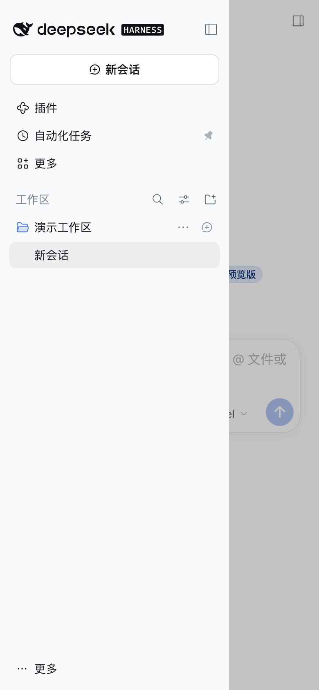
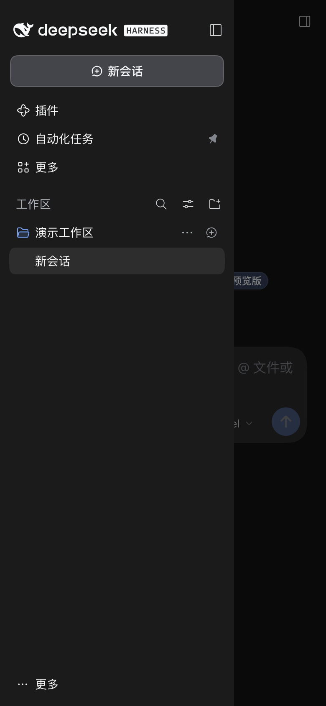
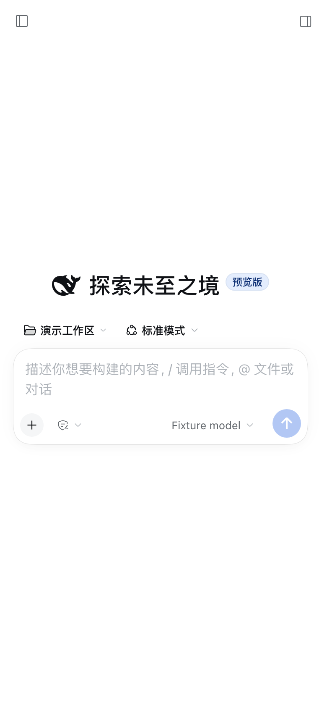
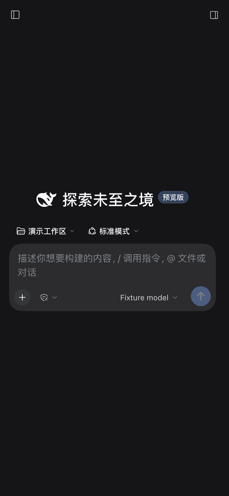

# dsh-swipe-back

[English](README.en.md) · [项目文档](docs/README.md)

手机端 Web UI（`< 768 px` 抽屉布局，且无弹窗/菜单打开）从左边缘向右滑动，按优先级依次触发第一项可用动作：

1. 抽屉（会话列表）开着 → 从任意位置向左或向右滑即可关闭（Safari 标签页也适用）；
2. 插件或计划任务处于子页 → 返回上一级；
3. 处于顶层全局面板 → 回到会话；
4. 右侧栏展开 → 收起右侧栏；
5. 以上皆无 → 打开会话列表抽屉。

第 2–5 步仅在「添加到主屏幕」PWA 或无历史记录的标签页生效，避免与 Safari 系统返回手势冲突。
可在 **移动端模块化改良计划** 中开启 **侧滑返回**，
或在源码目录运行 `pnpm install --frozen-lockfile` 后从 **插件 → 添加插件** 选择本目录。

## 界面实拍

截图来自 Chromium 移动视口触摸输入测试，不代表 iOS 系统原生返回手势。

| 操作结果 | 浅色 | 深色 |
| --- | --- | --- |
| 从左边缘右滑打开抽屉 |  |  |
| 在抽屉上左滑回到会话 |  |  |
